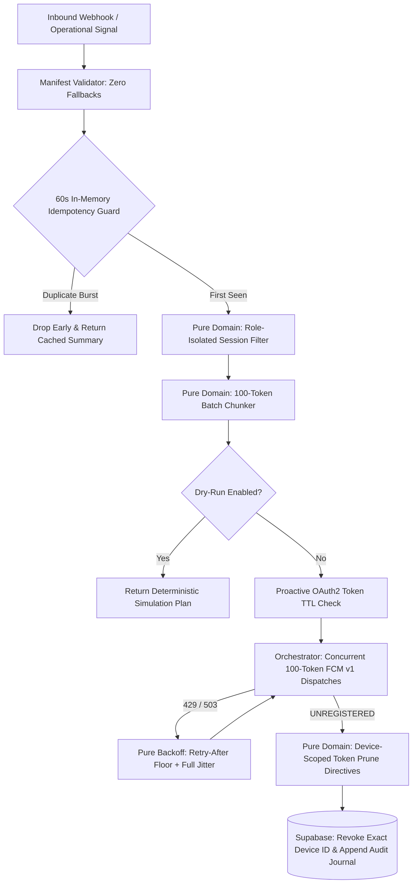

# `fcm-dispatch-orchestrator`

> **Zero-Framework Strict TypeScript, Native ESM & Supabase Dispatch Engine**  
> Role-isolated FCM v1 routing, 60-second idempotency cache, 100-token batch chunking, and tiered LLM signal triage.

---

## 🏛️ Business Problem & Operational Context

In multi-surface commerce ecosystems (where **POS Terminals**, **Kitchen Display Systems (KDS)**, **Manager Consoles**, **Rider Dispatchers**, and **Customer Storefronts** operate concurrently), naive push notification routing fails in three predictable ways:

1. **Cross-Device Token Collisions & Accidental Session Wiping:** Staff members frequently log into shared store tablets (KDS/POS) and personal smartphones (Manager Console) under the same account. Revoking an `UNREGISTERED` token by `account_id` when a manager uninstalls the app on their phone silently kills push alerts on the live kitchen tablet.
2. **Webhook Retry Storms:** Upstream payment and order-state webhooks frequently fire duplicate bursts within seconds, triggering phantom order alerts and duplicate database writes.
3. **Edge Function Timeouts & Rate Limits:** Unbounded FCM dispatches hit HTTP 429 quota walls, expire OAuth2 bearer tokens mid-batch, or exceed serverless execution budgets.

This library isolates **pure calculation logic** from **network/database orchestration**, governed by a **strict client manifest with zero fallback values**.

---

## 🧭 System Architecture



---

## 🔒 Core Engineering Invariants

### 1. Pure Calculation Functions vs. Orchestration
* **`src/domain/` (`dispatch-calculator.ts`, `backoff-policy.ts`):** 100% pure functions. Zero network calls, zero database reads, zero `Date.now()` or `Math.random()` calls inside domain logic. Every rule is deterministically testable against fake sandbox numbers.
* **`src/orchestration/` (`fcm-orchestrator.ts`, `idempotency-guard.ts`, `llm-triage-step.ts`):** Thin I/O shell managing OAuth2 token refresh, HTTP 429 retries, dry-run gating, and journaled Supabase persistence.

### 2. Strict Manifest Schema with No Fallback Values
* **`src/config/manifest-validator.ts`:** Never uses `||` or `??` to mask missing client configuration. If `maxBatchSize`, `dryRun`, or `llmRouting.anomalyConfidenceThreshold` is omitted or out of bounds, validation fails loudly at boot rather than executing against assumed defaults.

### 3. Explicit Database Migrations (No `IF NOT EXISTS` Drift)
* **`supabase/migrations/20261012093000_create_device_dispatch_ledger.sql`:** Intentionally avoids `CREATE TABLE IF NOT EXISTS`. Against an existing database, `IF NOT EXISTS` silently passes even when an older table lacks newly required columns or composite unique constraints (`uq_tenant_device_surface`), turning deployment-time schema mismatches into runtime data corruption.

### 4. LLMs as a Deterministic Pipeline Step (Tiered Routing)
* **`src/orchestration/llm-triage-step.ts`:** Routes high-frequency structured triage to low-latency models (`gemini-3.8-flash` / `claude-sonnet-5.5`) and only escalates to heavy reasoning models (`claude-opus-5.5` / `gemini-4-argon`) when extraction confidence drops below the manifest's strict threshold.

---

## 🧪 Running Sandbox Verification & Behavioral Tests

Tests are written with Node's native test runner (`node:test`) and capture **why** each business rule exists rather than restating the implementation.

```bash
npm install
npm run typecheck
npm test
```
