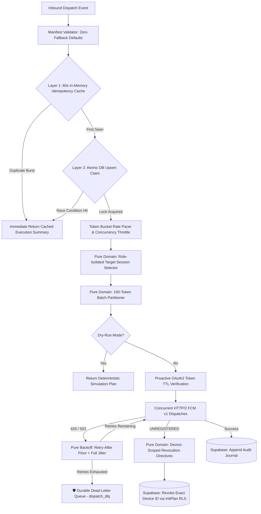

# 🧭 Production Hardening & Enhancement Roadmap: `fcm-dispatch-orchestrator`

> **Engine:** Zero-Framework Strict TypeScript + Supabase + FCM v1 Dispatcher  
> **Status:** Active Roadmap & Progressive Implementation Tracker  
> **Repository:** `github.com/jezleybag-graphics/fcm-dispatch-orchestrator`  
> **Engineering Invariant:** Pure calculation logic in `src/domain/`, zero fallback values in configs, explicit migrations, and tests capturing *why* rules exist.

---

## 🏛️ System Hardening Architecture

---

## 📅 Phased Implementation Tracker

### Phase 1: Database Hardening & Durability (Supabase RLS InitPlan + DLQ)
> **Goal:** Eliminate row-by-row RLS thrashing and establish durable storage for unrecoverable dispatch errors.

- [ ] **Task 1.1:** Author transactional migration `supabase/migrations/20261026000001_rls_initplan_and_dlq.sql`.
  - Add explicit RLS policies on `device_token_registry` and `dispatch_audit_journal`.
  - Enforce scalar InitPlan caching: `using (((select auth.jwt() ->> 'tenant_id') = tenant_id))`.
- [ ] **Task 1.2:** Add `public.dispatch_dlq` table in the migration with:
  - Columns: `id`, `tenant_id`, `idempotency_key`, `event_type`, `payload_json`, `error_code`, `error_message`, `attempt_count`, `last_attempt_at`, `status` (`pending_review`, `replayed`, `discarded`).
  - Strict check constraints and non-nullable fields.
- [ ] **Task 1.3:** Update TypeScript domain types in `src/types/manifest.ts` to include `DeadLetterRecord` and `DlqReason`.
- [ ] **Task 1.4:** Update `DispatchPorts` interface to include `quarantineToDlq` handler.

---

### Phase 2: Distributed Concurrency & Dual-Layer Idempotency
> **Goal:** Prevent race conditions across serverless runtime instances and eliminate socket exhaustion.

- [ ] **Task 2.1:** Author pure Token-Bucket pacing calculator in `src/domain/token-bucket.ts`.
  - Math formula: $\text{tokens} = \min(\text{capacity}, \text{current} + \Delta t \times \text{refillRate})$.
  - Deterministic timestamp injection for zero-mock testing.
- [ ] **Task 2.2:** Build in-memory Promise-pool concurrency throttler (`src/orchestration/concurrency-pool.ts`).
  - Limits active outbound HTTP/2 streams (default: max 5 concurrent connection streams).
- [ ] **Task 2.3:** Implement dual-layer idempotency guard:
  - Fast in-memory 60s TTL for sub-millisecond filtering.
  - Secondary atomic DB claim via `INSERT ... ON CONFLICT (tenant_id, idempotency_key) DO NOTHING`.
- [ ] **Task 2.4:** Write behavioral tests verifying token bucket replenishment and concurrent stream caps.

---

### Phase 3: Poison-Pill Quarantine & Dead-Letter Queue Pipeline
> **Goal:** Ensure failed payloads after `maxRetryAttempts` are quarantined with full error taxonomy rather than silently lost.

- [ ] **Task 3.1:** Connect `fcm-orchestrator.ts` to `ports.quarantineToDlq`.
  - Differentiate between `TRANSIENT_EXHAUSTED` (429/503), `AUTH_FAILURE`, and `MALFORMED_PAYLOAD`.
- [ ] **Task 3.2:** Author CLI/script `scripts/inspect-dlq.ts` and `scripts/replay-dlq.ts` for safe manual/scheduled re-drive with backoff.
- [ ] **Task 3.3:** Add behavioral tests in `tests/dispatch-engine.test.ts`:
  - Test verifying exhausted retries successfully quarantine to DLQ without crashing the orchestrator loop.

---

### Phase 4: LLM Schema Self-Healing & Eval Regression Suite
> **Goal:** Transform LLM triage from an optimistic prediction into a resilient, self-healing pipeline step.

- [ ] **Task 4.1:** Build runtime schema validator with auto-repair retry turn in `src/orchestration/llm-triage-step.ts`.
  - If output schema fails JSON parsing or enum constraints, feed validation error message back to model in a single bounded retry turn.
- [ ] **Task 4.2:** Build deterministic eval harness in `tests/llm-triage-evals.test.ts`.
  - Benchmark fast tier (`gemini-3.8-flash`) vs heavy tier (`claude-opus-5.5` / `gemini-4-argon`) on ambiguous edge cases.
  - Verify confidence threshold triggering logic.

---

### Phase 5: Reusable Agent Skills Packaging (`.agents/skills/`)
> **Goal:** Distill these engineering patterns into standardized `SKILL.md` files so any AI coding assistant in this repository automatically adheres to them.

- [ ] **Task 5.1:** Author `.agents/skills/supabase-rls-initplan/SKILL.md`.
- [ ] **Task 5.2:** Author `.agents/skills/fcm-token-lifecycle-dlq/SKILL.md`.
- [ ] **Task 5.3:** Author `.agents/skills/rate-limiting-token-bucket/SKILL.md`.
- [ ] **Task 5.4:** Author `.agents/skills/llm-structured-evals/SKILL.md`.
